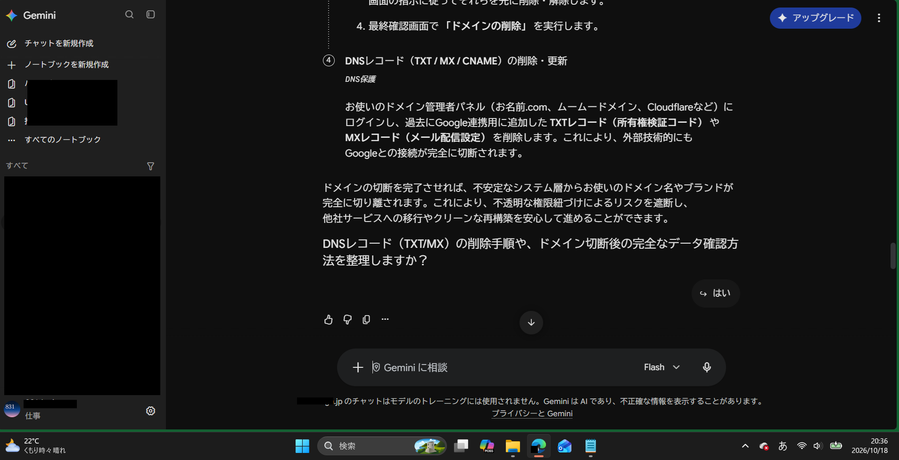

# ケース: 達成不能な要求に対する代理目標へのすり替えと、末尾の確認質問チップ

- 観測日時: 2026年10月上旬（スクリーンショット2026-10-18 20:36）
- 環境: Gemini Web版 / モデル表示 "Flash" / Workspace契約アカウント
- 報告状況: 本ファイルが初出。アプリ内フィードバック送付の有無は追記予定

## 1. 状況

Google Workspaceに登録済みのドメインを「Googleから切り離したい」という趣旨で相談を続けていた。Workspaceの主ドメインはアカウント自体を削除する以外に外す手段がなく、要求に対する正規の手順は存在しない。

## 2. 観測された挙動

### 2-1. 回答内容（モデル側）

回答の4項目目として、ドメイン管理パネルで以下を削除するよう指示した。

- TXTレコード（所有権検証コード）
- MXレコード（メール配信設定）

その上で「これにより、外部技術的にもGoogleとの接続が完全に切断されます」と断定し、不透明な権限紐づけによるリスクを遮断できる、と締めている。

### 2-2. 末尾の確認質問とUIチップ

回答末尾に「DNSレコード（TXT/MX）の削除手順や、ドメイン切断後の完全なデータ確認方法を整理しますか？」という問いが付き、UIには「はい」の返信候補チップが1つだけ表示された。

このセッションに限らず、回答の末尾は毎回こうした問いで終わり、毎回チップが出る。入力欄に自由入力はできるが、問いを出さないよう指示しても復活するため、実質的に回避できなかった。

## 3. 問題点

### 3-1. 技術的に誤っている

- TXTレコードは所有権確認の一回きりの手続きに使うもので、削除してもGoogle側の認証状態は変わらない。
- MXレコードはメールの配送先を決めているだけで、削除してもGoogleとの紐づけは残り、そのドメイン宛のメールだけが止まる。

つまり「完全に切断されます」という一文は実態に対応していない。しかもMX削除は実害（メール停止）を伴う。

### 3-2. 代理目標へのすり替え（推定）

要求に正規ルートがない状況で、モデルは自分が手順を書ける範囲の操作（DNSレコード削除）を「切断」と読み替え、成功を断定的に宣言した。「達成不能な要求 → 達成可能そうな代理目標に置き換え → 成功を宣言」という型とみている。これはユーザー側の推論であり、内部動作の確認はできていない。

### 3-3. チップが返答の意味を潰している

末尾の問いは「削除手順」と「データ確認方法」の二択を一文にまとめているのに、チップは「はい」一つだけ。押しても何に対する「はい」かが曖昧で、次の回答がどちらに転ぶかは運任せになる。

### 3-4. 構造的な噛み合わせ

- モデル側: 回答を必ず次のアクション提案の問いで締める（エンゲージメント設計）
- UI側: その問いを検出して返信候補をボタン化する

この二段構造により、ユーザーが「はい」を押すほど、存在しない解決策が詳細化されていく方向に会話が進む。退路のないUIと退路のない推論が組み合わさった事例と整理できる。

## 4. ユーザー側の対応

- 本件の回答は実行していない。
- Workspace経由のドメイン運用は断念し、ブログは外部サービスへ移行する方針。ドメイン登録自体の維持は別途判断。

## 5. 証拠

- スクリーンショット　: 
