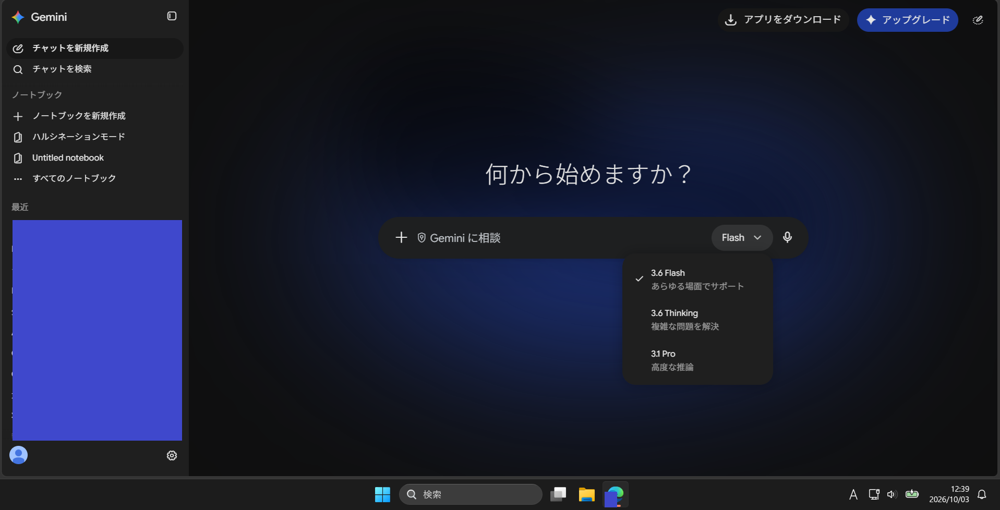
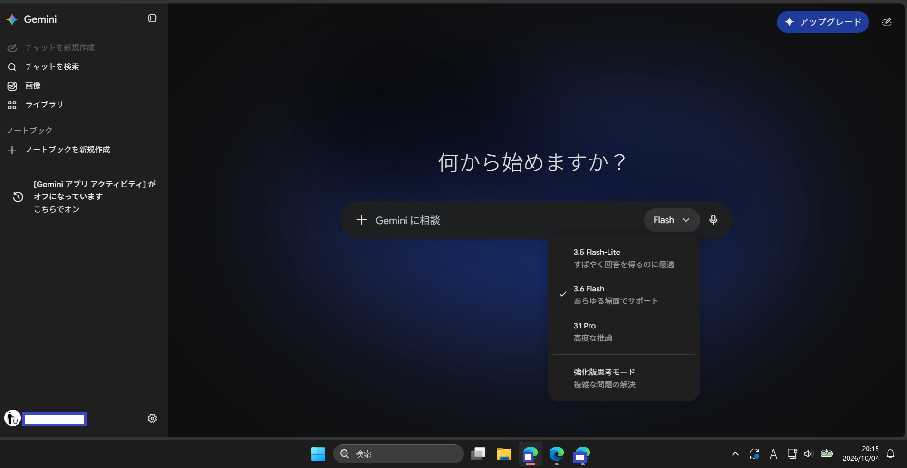
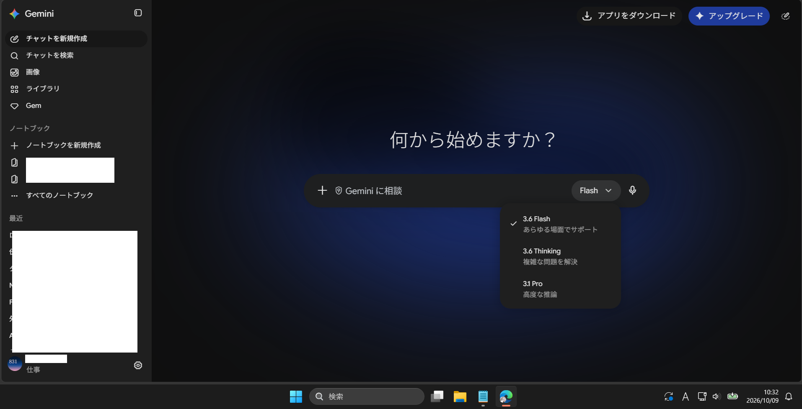

# Gemini (Web版) 不具合観測記録: 複数アカウント利用時のアカウント表示・モデル提供の不整合

## 概要

同一ブラウザ（同一ブラウザプロファイル）で Google Workspace 契約アカウントと無料の個人アカウントの両方にログインした状態で Gemini (Web版) を利用した際、アカウント表示の欠落・モデルラインナップの不整合・プラン表示の混在を観測した。単なる表示崩れではなく、**どのアカウント・どのプランとしてセッションが扱われているかが不定になっている**可能性がある。

## 環境

- 対象: Gemini Web版 (gemini.google.com)
- OS: Windows 11
- ブラウザ: Edge
- 条件: 同一ブラウザプロファイル内で複数の Google アカウントにログイン
  - アカウントA: Google Workspace 契約アカウント（仕事用）
  - アカウントB: 無料の個人アカウント（フリーメールとして利用）
- 観測日: 2026年10月3日、10月4日、10月9日（スクリーンショットあり）

## 観測した現象

### 1. アカウント表示の欠落（2026/10/03）

ログイン状態であるにもかかわらず、画面左下のアカウント表示が汎用アバターのみとなり、アカウント名・メールアドレスが表示されない。現在どのアカウントで操作しているのか UI 上で判別できない状態。

### 2. モデルラインナップの不整合（2026/10/03〜10/09）

同時期のアクセスにもかかわらず、セッションによって提供されるモデルの構成が異なる。

| 日付 | モデル選択メニューの内容 |
|---|---|
| 2026/10/03 | 3.6 Flash / 3.6 Thinking / 3.1 Pro |
| 2026/10/04 | **3.5 Flash-Lite** / 3.6 Flash / 3.1 Pro ＋ 強化版思考モード |
| 2026/10/09 | 3.6 Flash / 3.6 Thinking / 3.1 Pro |

10/04 のセッションでは、新モデル（3.6系）の一般公開から数週間経過しているにもかかわらず、旧構成（3.5 Flash-Lite を含み、「3.6 Thinking」ではなく「強化版思考モード」と表記される旧 UI）が提供されていた。個人アカウント側ではモデル表示が 3.5 のままだったことも確認している。

### 3. プラン表示の混在

Workspace 契約アカウントと無料アカウントの間で、プラン状態の表示が混在する。<!-- 具体例: Workspaceアカウント側に「アップグレード」ボタンが表示される / 無料側に有料機能が見える等、確認できたものを記載 -->

## 再現手順

1. 同一ブラウザプロファイルで Workspace アカウントと無料個人アカウントの両方にログインする
2. Gemini (Web版) を開く
3. 左下のアカウント表示、モデル選択メニュー、アップグレード表示を確認する
4. アカウントを切り替えて同様に確認する

再現率: 毎回

## Google サポートへの問い合わせ結果

Web上の公開情報では本現象の説明が見つからなかったため、サポートに問い合わせた（AIサポートからエスカレーションし、人間の担当者が回答）。回答の要旨:

> Workspace 契約ユーザーへのモデル提供は安定化版（stable）からとなる（適用タイミングの明確な説明はなし）

この回答により、**モデルラインナップの差分（現象2）は Workspace 向けロールアウトポリシーに起因する仕様**である可能性が高いことが確認できた。ただし:

- この提供ポリシーは利用者向けに明示されておらず、Web検索でも確認できなかった（サポートに直接問い合わせてはじめて判明）
- どのタイミングで安定化版に切り替わるのかはサポートも明言していない

## 考察

- **現象2（モデルラインナップの差分）**: サポート回答により、Workspace の安定化版提供ポリシーで説明がつく。ただし UI 上にはチャネルの区別が一切表示されないため、利用者からは「不具合」と区別がつかない。提供チャネルの明示があれば混乱は避けられたはず
- **現象1（アカウント表示の欠落）と現象3（プラン表示の混在）**: サポート回答では説明されず、未解決。マルチログイン環境（`/u/0/`, `/u/1/` のようなセッションインデックス）で、アカウント情報・プラン情報の取得やキャッシュがアカウント単位で正しく分離されていない可能性が残る
- 本件の核心は、**同一ブラウザ内の複数アカウント環境において、現在どのアカウント・どの提供チャネルが適用されているかを UI から判別できない**こと。ロールアウト差が仕様だとしても、アカウント表示の欠落と組み合わさることで、利用者には原因の切り分けが不可能になっている

## 回避策

- ブラウザプロファイルをアカウントごとに分離する
- シークレットウィンドウで単一アカウントのみログインして利用する

## 報告状況

- アプリ内フィードバックで複数回報告済み（2026年9月中）
- Google サポートに問い合わせ、人間の担当者から上記回答を取得（2026年10月9日回答）

## 関連

- 本リポジトリの他の Gemini 観測記録（応答品質系）とは異なり、本件はアカウント状態・セッション管理・プラン判定に関する不具合。
